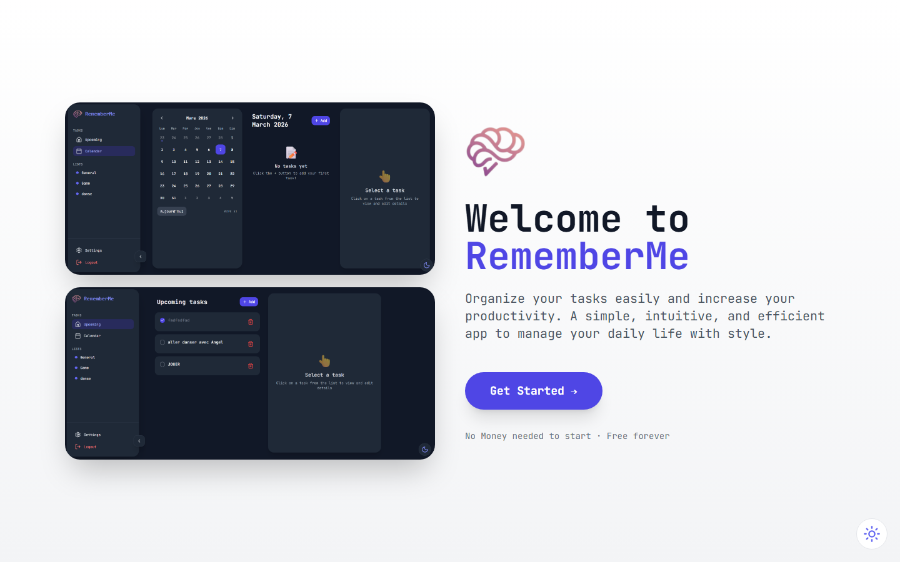
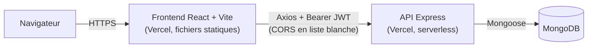
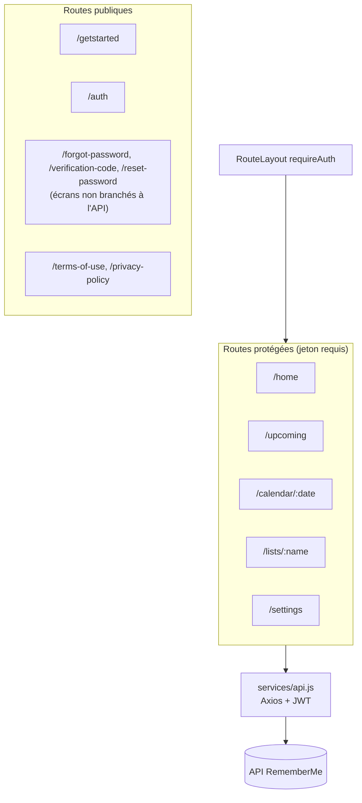

# RememberMe — Frontend

> Gestionnaire de tâches et de rappels organisés par listes. **Ce dépôt est l'interface web.** L'API est dans [Backend_RememberMe](https://github.com/nagoloumdaniel/Backend_RememberMe) : les deux dépôts forment un seul projet, **RememberMe**.


**Application en ligne : https://rememberme-lemon-chi.vercel.app** · **API : https://backend-remember-me.vercel.app**



## Le projet RememberMe

| Partie | Dépôt | Rôle | Production |
|---|---|---|---|
| Frontend (ce dépôt) | [Frontend_RememberMe](https://github.com/nagoloumdaniel/Frontend_RememberMe) | SPA React : interface, thème, calendrier | https://rememberme-lemon-chi.vercel.app |
| Backend | [Backend_RememberMe](https://github.com/nagoloumdaniel/Backend_RememberMe) | API REST Node/Express, MongoDB, JWT | https://backend-remember-me.vercel.app |



## Ce que fait l'application

- **Compte** : inscription et connexion par email et mot de passe (jeton JWT).
- **Tâches** : création, modification, suppression, marquage « terminé », priorité, date et heure d'échéance.
- **Listes** : regroupement des tâches dans des listes personnalisées (`/lists/:name`).
- **Calendrier** : choix d'une date et navigation par mois (`/calendar/:date`).
- **À venir** : tâches à échéance proche (`/upcoming`).
- **Paramètres** : profil et préférences de notification (activation, heure).
- **Thème clair / sombre** : bascule mémorisée, préférence système prise en compte.
- **Notifications** : retours utilisateur sous forme de toasts.
- **Pages légales** : conditions d'utilisation et politique de confidentialité.

### Limite connue : mot de passe oublié

Les écrans « mot de passe oublié », « code de vérification » et « réinitialisation » existent dans l'interface, mais **ils ne sont pas branchés à l'API** : le backend n'expose aucun endpoint correspondant et les écrans simulent seulement l'attente (`setTimeout`). Cette fonction est donc **incomplète** : elle ne permet pas de récupérer un compte aujourd'hui.

## Langues

L'interface est rédigée en anglais. Un bouton FR/EN s'appuie sur la **traduction native du navigateur** (paramètre `_translate_to`) : il n'y a ni bibliothèque d'internationalisation ni fichiers de traduction maintenus. La qualité de la traduction dépend donc du navigateur.

## Stack technique (versions installées)

| Catégorie | Technologies |
|---|---|
| Framework | React 19.2.3, Vite 7.3.0 |
| Style | Tailwind CSS 3.4.1, PostCSS, Autoprefixer |
| Routage | React Router 7.11.0 |
| HTTP | Axios 1.13.2 (intercepteur JWT, déconnexion sur 401) |
| UI | lucide-react 0.562.0, react-toastify 11.0.5 |
| Qualité | ESLint 9.39.2 (hooks, refresh) |

## Architecture



Le jeton est stocké dans `localStorage` ; sans jeton, `RouteLayout` redirige vers `/auth`, et une réponse 401 de l'API vide la session.

## Sécurité côté client

- Le contrôle d'accès de l'interface n'est que de l'affichage : la protection réelle des données est assurée par l'API (JWT vérifié, données filtrées par utilisateur).
- Aucun secret dans le dépôt : seule `VITE_API_URL` (une URL publique) est configurable, et `.env` est ignoré par Git.
- Point d'attention : le jeton en `localStorage` est exposé à une éventuelle faille XSS (compromis courant des SPA).
- Signalement de vulnérabilité : voir [SECURITY.md](SECURITY.md).

## SEO

Seule la page d'accueil est destinée à l'indexation. `index.html` fournit title, description, canonical, Open Graph et Twitter Card ; `public/robots.txt` interdit l'exploration des espaces connectés ; `public/sitemap.xml` ne liste que `/`. Limite : c'est une SPA sans rendu serveur, toutes les routes partagent les mêmes balises.

## Défis rencontrés

- **Déploiement Vercel** : plusieurs essais de `vercel.json` ont jalonné l'historique, et l'accès direct à une route du routeur (par exemple `/auth`) renvoyait 404 en production. Un `vercel.json` avec réécriture vers `index.html` est désormais fourni.
- **CORS** : l'API n'accepte qu'une liste blanche d'origines (le domaine de production, `localhost:5173` et `localhost:3000`). Un autre domaine (prévisualisation Vercel) sera refusé tant qu'il n'est pas ajouté côté backend.
- **URL de l'API** : les URL codées en dur ont été remplacées par la variable `VITE_API_URL`.
- **Secrets** : une alerte de secret a été traitée côté backend (voir le [README du backend](https://github.com/nagoloumdaniel/Backend_RememberMe)).

## Installation locale

Prérequis : Node.js 18+ et l'API [Backend_RememberMe](https://github.com/nagoloumdaniel/Backend_RememberMe) démarrée (ou l'API de production).

```bash
git clone https://github.com/nagoloumdaniel/Frontend_RememberMe.git
cd Frontend_RememberMe
npm install

# Optionnel : sinon l'API de production est utilisée
echo "VITE_API_URL=http://localhost:5000/api" > .env

npm run dev       # serveur de développement
npm run lint      # ESLint
npm run build     # build de production dans dist/
npm run preview   # prévisualiser le build
```

## Statut

**Fonctionnel et en production.** Aucun test automatisé côté frontend à ce jour (le backend a une suite d'intégration). Fonction incomplète : récupération de mot de passe (voir plus haut).

## Transparence sur l'outillage

Projet développé par Daniel Nagoloum Talla. Certains commits de documentation portent un trailer `Co-Authored-By: Claude` : ils ont été rédigés avec l'assistance d'un outil d'IA (Claude, Anthropic).

## Droits

**Aucune licence n'est accordée : tous droits réservés par défaut.** Le code est consultable sur GitHub, mais sa réutilisation, copie ou redistribution nécessite l'accord de l'auteur. Pour demander une autorisation, ouvrez une issue.

---

[GitHub](https://github.com/nagoloumdaniel) · [Portfolio](https://nagoloum.vercel.app)
